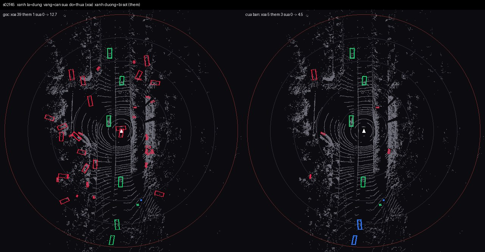

# Báo cáo Day 14 — Nguyễn Trường Giang — 2A202603073

- Mã học viên dùng với `--student`: `073`
- `seed_tag` trong `frames_A.txt`: `393590736f`

## 1. Dự đoán trước sweep (bước 5b)

Ghi **trước** khi chạy `scripts/pp_sweep.py`, rồi commit và push ngay (lịch sử commit là bằng chứng thời điểm viết). Không sửa phần này sau khi có kết quả.

- Tham số tôi nghĩ giảm công sửa nhiều nhất: tăng `score_thr` (dự đoán lên khoảng `0.6`).
- Vì sao (nhìn ảnh BEV tập A: box thừa nhiều hay box sót nhiều?): Tập A đang thừa rất nhiều hộp dự đoán (98 hộp cần xóa so với chỉ 3 hộp cần thêm, chiếm phần lớn tổng chi phí gốc 32.9). Bản chất các hộp thừa trên ảnh BEV và camera chủ yếu là hộp nhiễu bám vào bụi cây ven đường có độ tin cậy thấp, nên tăng `score_thr` sẽ lọc bớt lượng lớn hộp thừa và giảm tổng công sửa nhiều nhất.

## 2. Tập A: sửa tay và tune

| Cấu hình | Xóa | Thêm | Sửa | Chi phí |
|---|---:|---:|---:|---:|
| Gốc | 99 | 5 | 1 | 35.2 |
| `best_config.json` | 10 | 11 | 0 | 14.0 |

*(Ghi chú: Sau khi đã commit bước 5b và giữ nguyên mục 1 theo quy định, tôi rà soát QA lại `ref_A.json` bằng 7 góc camera và `vf_qa` — xóa 1 hộp `Cyclist` nhiễu trên bụi cây và thêm 1 `Cyclist` bị sót ở `s01f20`, chỉnh lại đáy/kích thước `Bus`, `Car`, `Pedestrian` bị cảnh báo và thêm 1 `Pedestrian` bị sót ở `s03f32` — nên tổng tham chiếu tăng từ 29 lên 30 hộp và chi phí cấu hình gốc cập nhật từ `32.9` lên `35.2`; kết quả cấu hình tốt nhất `best_config.json` vẫn giữ nguyên `score_thr = 0.5, min_points = 0`.)*

- Tham số đã đổi trong `best_config.json`: `score_thr: 0.1 -> 0.5` (giữ `min_points = 0`; ở `score_thr = 0.5`, cả 3 mức `min_points = 0, 5, 10` đều cho cùng kết quả `xóa 10, thêm 11, sửa 0 → chi phí 14.0`; còn khi tăng lên `score_thr = 0.6`, chi phí tăng lên `15.2` với `xóa 4, thêm 14, sửa 0`).
- Kết quả leave-one-out (dán các dòng `scripts/pp_sweep.py` in ra):
  ```text
  Leave-one-out (chọn trên các frame còn lại, chấm trên frame bỏ ra):
    s01f20: cấu hình chọn {'score_thr': '0.6', 'min_points': '0'} → 7.0 (tốt nhất có thể 5.2)
    s02f45: cấu hình chọn {'score_thr': '0.5', 'min_points': '0'} → 4.5 (tốt nhất có thể 4.3)
    s03f32: cấu hình chọn {'score_thr': '0.5', 'min_points': '0'} → 3.9 (tốt nhất có thể 3.9)
  ```
- Cấu hình có ổn định trên từng frame không? Vì sao tôi vẫn chọn (hoặc không chọn) nó: Cấu hình `score_thr = 0.5, min_points = 0` **chỉ ổn định một phần** qua 3 frame: trên `s02f45` (`4.5` so với tốt nhất `4.3`) và `s03f32` (`3.9` trùng mức tốt nhất `3.9`), ngưỡng `0.5` sát tối ưu; nhưng khi bỏ `s01f20` ra ngoài, hai frame còn lại chọn `score_thr = 0.6` khiến chi phí trên `s01f20` tăng lên `7.0` (lệch `+1.8` so với mức tốt nhất có thể `5.2` ở `score_thr = 0.4`), do `s01f20` đông vật thể hơn và có nhiều hộp thật rơi vào vùng điểm `0.4–0.6`. Tôi vẫn chọn `score_thr = 0.5, min_points = 0` cho tập B vì đây là điểm cân bằng tốt nhất trên cả 3 frame tập A (giảm mạnh hộp nhiễu ven đường mà không làm mất thêm vật thể thật như ngưỡng `0.6`, nơi mỗi hộp sót bị phạt `1.0` nặng gấp hơn 3 lần hộp thừa `0.3`), còn `min_points` không tạo khác biệt ở `score_thr = 0.5` nên giữ `0` để tránh lọc nhầm vật thể ở xa ít điểm LiDAR.

## 3. Trước/sau (bước 8)



- `scripts/pp_compare.py` báo giảm **60%** công sửa trên tập A (`35.2 → 14.0`: `s01f20` `8.6 → 5.6`, `s02f45` `12.7 → 4.5`, `s03f32` `13.9 → 3.9`).
- Dự đoán ở mục 1 đúng hay sai? Giải thích bằng số box xóa/thêm/sửa: Dự đoán ở mục 1 **đúng về tham số chính** (tăng `score_thr` là yếu tố giảm chi phí mạnh nhất, trong khi `min_points` gần như không tác động khi `score_thr >= 0.5`), nhưng **hơi quá tay về mức ngưỡng** (dự đoán `≈ 0.6` thay vì tối ưu thực tế `0.5`). Cụ thể:
  - Từ `score_thr = 0.1` lên `0.5`: số hộp cần **xóa** giảm mạnh từ `99` xuống `10` (giảm `89 × 0.3 = 26.7` điểm chi phí) và số hộp cần **sửa** giảm từ `1` xuống `0` (`-0.5`), trong khi số hộp cần **thêm** chỉ tăng từ `5` lên `11` (`+6.0`), giúp tổng chi phí giảm từ `35.2` xuống `14.0` (`-21.2`).
  - Khi tăng tiếp từ `0.5` lên `0.6` như dự đoán: số hộp cần **xóa** chỉ giảm thêm `6` hộp (`10 → 4`, tiết kiệm `1.8`), nhưng số hộp bị sót phải **thêm** tăng thêm `3` hộp (`11 → 14`, phạt `+3.0`), làm tổng chi phí tăng ngược lên `15.2` (`+1.2`). Điều này cho thấy khi phần lớn hộp nhiễu điểm thấp đã bị lọc ở `0.5`, tăng ngưỡng thêm sẽ phản tác dụng vì trọng số `thêm` (`1.0`) lớn hơn nhiều trọng số `xóa` (`0.3`).

## 4. Tập B

Số đo từ `scripts/pp_prelabel.py --frames d14_073/frames_B.txt --config d14_073/best_config.json --gt d14_073/ref_B.json`:

| Xóa | Thêm | Sửa | Chi phí |
|---:|---:|---:|---:|
| 38 | 44 | 5 | 57.9 |

*(Tổng trên 12 frame tập B: GT `159` hộp, dự đoán `153` hộp, khớp `115` hộp; chi phí trung bình `4.83`/frame, gần tương đương mức `4.67`/frame trên tập A.)*

- Loại box tốn công sửa nhất ở tập B:
  1. **`Cyclist` (tốn công nhất — chi phí `22.3`, chiếm `38.5%` tổng chi phí):** gồm `21` hộp cần **xóa** (`6.3`, chủ yếu là hộp dự đoán nhầm vào bụi cây, cột đèn, biển báo, rào chắn, xe đạp dựng không có người ở `s01f33`, `s03f44`, `s03f59`, `s04f05`, `s05f00`, `s05f46`) và `16` hộp cần **thêm** (`16.0`, do model bỏ sót người đi xe máy/xe đạp trên vạch sang đường và làn xe đạp như ở `s01f01`, `s01f57`, `s03f44`, `s04f54`, `s05f23`, hoặc nhận nhầm xe máy thành hộp `Car` quá lớn ở `s01f01`, `s04f30` khiến BEV IoU `< 0.3`).
  2. **`Car` (chi phí `14.6`, chiếm `25.2%`):** `17` hộp cần **xóa** (`5.1`, gồm nhiễu bụi cây/rào chắn, 1 hộp trùng lên chính xe ego ở `s04f05`, và các hộp `Car` đặt nhầm lên `Cyclist`), `9` hộp cần **thêm** (`9.0`, xe con/MPV/van bị khuất một phần ở `s01f01`, `s03f03`, `s04f05`, `s05f23`) và `1` hộp cần **sửa** (`0.5`, căn lại vị trí xe sau bụi cây ở `s01f33`). Ngoài ra trên CVAT còn phải xoay lại hướng đầu xe 180° cho nhiều hộp `Car` ngược chiều (không tính vào `edit` của công thức).
  3. **`Pedestrian` (chi phí `12.0`, chiếm `20.7%`):** ở ngưỡng `score_thr = 0.5`, model dự đoán **0 hộp `Pedestrian`** trên toàn bộ 12 frame nên phải **thêm** tay toàn bộ `12/12` người đi bộ (`12.0`).
  4. **`Truck` và `Bus` (tổng chi phí `9.0`, chiếm `15.5%` — `Truck`: `6.0`, `Bus`: `3.0`):** model KITTI dự đoán **0 `Truck`** và **0 `Bus`**. Với `Truck` (`8` xe thật), `4` xe bị bỏ sót hoàn toàn (xe thùng trắng ở `s01f01`, xe tải van Iveco Daily và xe ben xanh ở `s05f46`, xe ben ở `s05f23` → `thêm 4`) và `4` xe bị nhận nhầm thành `Car` kích thước nhỏ (xe tải nhẹ ở `s01f01`, xe van chở hàng ở `s03f03`, xe ben lớn ở `s05f00` và `s05f46` → `sửa 4`). Với `Bus`, cả `3/3` xe buýt (`s01f01`, `s03f59`, `s04f30`) đều phải vẽ mới hoàn toàn (`thêm 3`).
- Ghi nhận trường hợp nghi vấn theo Guideline mục 4: ở `s04f05` (`cam03`, khoảng `x ≈ 14–18 m, y ≈ -25 đến -35 m`), có một xe buýt xanh-trắng nằm sau xe cứu thương `#3` nhưng bị che khuất gần như hoàn toàn tia LiDAR (`LOW_VISIBILITY` / `UNCERTAIN_SCOPE`, không đủ 15–20% thể tích điểm) nên được bỏ qua theo quy tắc mục 2.6.

## 5. Giới hạn

- **Cỡ mẫu tune quá nhỏ (chỉ 3 frame tập A):** 3 frame chưa đại diện đủ cho mọi kiểu bối cảnh giao thông trong tập B (ngã tư đông xe máy/người đi bộ ở `s01f01`, `s05f23`, hay đường có nhiều xe tải nặng/xe buýt ở `s05f00`, `s05f46`). Chính kết quả leave-one-out trên `s01f20` (`7.0` so với tốt nhất `5.2`) đã cho thấy việc chọn tham số trên 2–3 frame rất nhạy với phân bố cảnh.
- **Lệch miền dữ liệu giữa KITTI và VF (domain gap):** trọng số PointPillars huấn luyện trên KITTI (LiDAR 64 tia, chỉ góc nhìn phía trước và chỉ có 3 lớp `Car`, `Cyclist`, `Pedestrian`) không có lớp `Truck`/`Bus`, và khi nâng `score_thr = 0.5` để cắt hộp nhiễu thì gần như triệt tiêu luôn khả năng phát hiện `Pedestrian` (`0/12` hộp trên tập B) đồng thời vẫn bỏ sót nhiều `Cyclist` và sinh hộp giả trên bụi cây/rào chắn.
- **Chi phí sửa chỉ là công thức ước lượng, chưa phải thời gian thao tác thật:** công thức `0.3·xóa + 1.0·thêm + 0.5·sửa` không đo thời gian thực trên CVAT, bỏ qua công căn lại độ cao `z` (hộp lơ lửng/chìm), xoay đầu xe ngược 180°, và thời gian người gán nhãn rà soát đối chiếu 7 góc camera; vì vậy mức giảm 60% chi phí trên tập A không thể quy đổi thành phần trăm hay số giờ công tiết kiệm thực tế.
- **Giới hạn cảm biến và độ bất định ở khoảng cách xa:** gần ranh giới `50 m` hoặc sau vật cản lớn (như xe buýt sau xe cứu thương ở `s04f05`), đám mây điểm LiDAR rất thưa khiến việc ước lượng kích thước và quyết định vẽ hay bỏ qua vẫn phụ thuộc vào nhận định thủ công.
